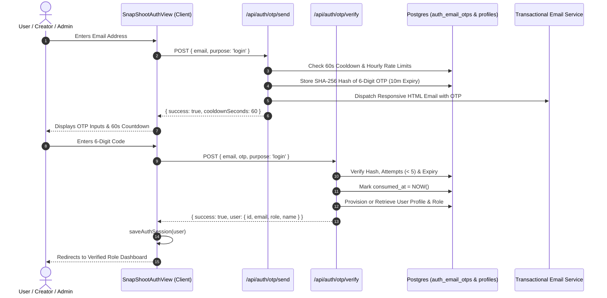

# Authentication & OTP Verification Workflow

## 1. Overview

SnapShoot implements a multi-channel, enterprise-grade authentication system supporting **Email One-Time Password (OTP)**, **Password-Based Login**, and **SMS OTP**.



---

## 2. Security Specifications

### 2.1 Cryptographic Random OTP Generation
OTPs are generated using Node.js `crypto.randomInt(100000, 999999)` ensuring uniform distribution:
```ts
const otpCode = crypto.randomInt(100000, 999999).toString();
const otpHash = crypto
  .createHash('sha256')
  .update(`${normalizedEmail}:${otpCode}`)
  .digest('hex');
```

### 2.2 Brute-Force & Rate-Limiting Controls
1. **Cooldown Window**: 60 seconds between consecutive OTP requests for the same email address.
2. **Hourly Throttling**: Maximum 5 OTP requests per hour per email.
3. **Attempt Capping**: Maximum 5 failed verification attempts per OTP. Once exceeded, the code is permanently invalidated.
4. **Time-To-Live (TTL)**: OTPs expire automatically after 10 minutes (`expires_at < NOW()`).
5. **Anti-Enumeration**: Both `/api/auth/otp/send` and `/api/auth/otp/verify` return generic status messages to prevent leaking whether an email address is registered on the platform.
6. **Zero Plaintext Leakage**: Plaintext OTP codes are never logged to console in production and never returned in API responses.

---

## 3. Database Model (`auth_email_otps`)

```sql
CREATE TABLE IF NOT EXISTS public.auth_email_otps (
  id UUID PRIMARY KEY DEFAULT gen_random_uuid(),
  email TEXT NOT NULL,
  otp_hash TEXT NOT NULL,
  purpose TEXT NOT NULL DEFAULT 'login',
  attempts INT NOT NULL DEFAULT 0,
  max_attempts INT NOT NULL DEFAULT 5,
  expires_at TIMESTAMPTZ NOT NULL,
  consumed_at TIMESTAMPTZ,
  created_at TIMESTAMPTZ NOT NULL DEFAULT NOW()
);

CREATE INDEX IF NOT EXISTS idx_auth_email_otps_lookup 
ON public.auth_email_otps(email, expires_at) 
WHERE consumed_at IS NULL;
```

---

## 4. Role-Based Navigation & Redirection Rules

Post-authentication redirection is handled strictly by `resolvePostAuthRedirect()` in `apps/web/src/lib/safeRedirect.ts`:

| Authenticated Role | Destination URL | Authorization Boundary |
|---|---|---|
| `customer` | `/customer/dashboard` | Cannot access `/photographer/*` or `/admin/*` |
| `creator` / `photographer` | `/photographer/dashboard` | Subject to admin verification status; cannot access `/admin/*` |
| `admin` / `owner` | `/admin/dashboard` | Restricted to verified admin permissions in `profiles.role` |

Public marketing paths (e.g. `/`, `/explore`, `/categories`) will **never** override the user's role-appropriate dashboard upon login. Deep booking links (e.g. `/photographers/[id]`) are preserved to maintain booking continuity.
