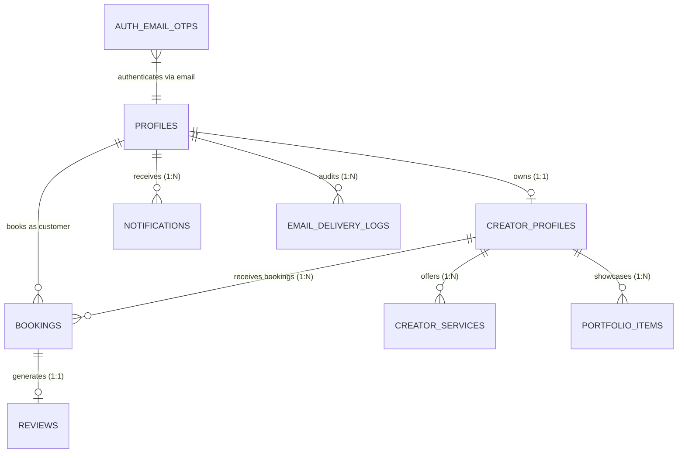

# SnapShoot Database Schema & Data Dictionary

## 1. Overview

SnapShoot uses PostgreSQL 15 managed through Supabase with Row Level Security (RLS) enabled on all public tables. All mutations are validated through database constraints and server-side route policies.

---

## 2. Table Specifications

### 2.1 `profiles`
Central user identity and role authorization table.
| Column | Type | Constraints | Description |
|---|---|---|---|
| `id` | `UUID` | PRIMARY KEY, REFERENCES auth.users(id) | Unique user ID |
| `email` | `TEXT` | NOT NULL, UNIQUE | User login email |
| `full_name` | `TEXT` | NOT NULL | Display name |
| `phone_number`| `TEXT` | NULL | Contact mobile number |
| `role` | `TEXT` | NOT NULL DEFAULT 'customer' | 'customer', 'creator', 'admin', 'owner' |
| `account_status`| `TEXT` | NOT NULL DEFAULT 'active' | 'active', 'suspended', 'pending_kyc' |
| `avatar_url` | `TEXT` | NULL | User profile image |
| `created_at` | `TIMESTAMPTZ` | DEFAULT NOW() | Record creation |

---

### 2.2 `creator_profiles`
Professional studio details, cover banner, and travel pricing rules.
| Column | Type | Constraints | Description |
|---|---|---|---|
| `id` | `UUID` | PRIMARY KEY DEFAULT gen_random_uuid() | Creator profile ID |
| `user_id` | `UUID` | NOT NULL, UNIQUE, REFERENCES profiles(id) | Profile owner |
| `business_name`| `TEXT` | NOT NULL | Studio or brand name |
| `bio` | `TEXT` | NULL | Professional biography |
| `experience_years` | `INT` | DEFAULT 1 | Years in industry |
| `city` | `TEXT` | NOT NULL | Primary hub city |
| `base_address`| `TEXT` | NULL | Studio location address |
| `base_latitude`| `FLOAT8` | NULL | Studio latitude |
| `base_longitude`| `FLOAT8` | NULL | Studio longitude |
| `service_radius_km` | `INT` | DEFAULT 50 | Max shoot radius |
| `included_travel_km`| `INT` | DEFAULT 10 | Free travel distance |
| `travel_fee_per_km` | `NUMERIC` | DEFAULT 20.00 | Rate per chargeable km |
| `min_travel_fee` | `NUMERIC` | DEFAULT 0.00 | Floor travel charge |
| `max_travel_fee` | `NUMERIC` | NULL | Ceiling travel charge |
| `allow_out_of_area` | `BOOLEAN` | DEFAULT false | Accept beyond radius |
| `cover_image_url` | `TEXT` | NULL | Studio cover banner image |
| `verification_status`| `TEXT` | DEFAULT 'pending' | 'draft', 'pending', 'approved', 'rejected', 'suspended' |
| `rejection_reason` | `TEXT` | NULL | Mandatory on rejection |
| `created_at` | `TIMESTAMPTZ` | DEFAULT NOW() | Profile submission timestamp |

---

### 2.3 `portfolio_items`
Independent gallery photographs (strictly separated from cover banners).
| Column | Type | Constraints | Description |
|---|---|---|---|
| `id` | `UUID` | PRIMARY KEY DEFAULT gen_random_uuid() | Item ID |
| `creator_profile_id`| `UUID` | NOT NULL, REFERENCES creator_profiles(id) | Creator link |
| `image_url` | `TEXT` | NOT NULL | High-res storage URL |
| `title` | `TEXT` | NULL | Photograph caption |
| `category` | `TEXT` | DEFAULT 'general' | Photography category |
| `sort_order` | `INT` | DEFAULT 0 | Display priority |
| `created_at` | `TIMESTAMPTZ` | DEFAULT NOW() | Upload timestamp |

---

### 2.4 `bookings`
Marketplace bookings with immutable financial travel snapshots.
| Column | Type | Constraints | Description |
|---|---|---|---|
| `id` | `UUID` | PRIMARY KEY DEFAULT gen_random_uuid() | Booking ID |
| `customer_id` | `UUID` | NOT NULL, REFERENCES profiles(id) | Customer link |
| `creator_profile_id`| `UUID` | NOT NULL, REFERENCES creator_profiles(id) | Photographer link |
| `service_id` | `UUID` | REFERENCES creator_services(id) | Service package link |
| `event_date` | `DATE` | NOT NULL | Event shoot date |
| `start_time` | `TEXT` | NOT NULL | Scheduled start time |
| `duration_hours` | `INT` | DEFAULT 2 | Session duration |
| `location` | `TEXT` | NOT NULL | Venue name / address |
| `city` | `TEXT` | NOT NULL | Event city |
| `travel_distance_km`| `FLOAT8` | NOT NULL DEFAULT 0 | Geodesic Haversine km |
| `distance_method` | `TEXT` | DEFAULT 'haversine_geodesic' | Distance calculation type |
| `included_travel_km`| `FLOAT8` | DEFAULT 0 | Included km applied |
| `chargeable_distance_km`| `FLOAT8` | DEFAULT 0 | Billable travel km |
| `travel_rate_per_km`| `NUMERIC` | DEFAULT 0 | Applied rate per km |
| `travel_fee` | `NUMERIC` | DEFAULT 0 | Calculated travel cost |
| `total_amount` | `NUMERIC` | NOT NULL | Authoritative total |
| `pricing_breakdown` | `JSONB` | NOT NULL | Complete financial snapshot |
| `status` | `TEXT` | DEFAULT 'pending' | 'pending', 'confirmed', 'completed', 'cancelled', 'disputed' |
| `payment_status` | `TEXT` | DEFAULT 'pending' | 'pending', 'paid', 'refunded' |

---

### 2.5 `email_delivery_logs`
Delivery audit records for transactional emails.
| Column | Type | Constraints | Description |
|---|---|---|---|
| `id` | `UUID` | PRIMARY KEY DEFAULT gen_random_uuid() | Log ID |
| `recipient_email` | `TEXT` | NOT NULL | Destination email |
| `template_name` | `TEXT` | NOT NULL | Template identifier |
| `event_type` | `TEXT` | NOT NULL | Event classification |
| `subject` | `TEXT` | NOT NULL | Email subject line |
| `status` | `TEXT` | NOT NULL DEFAULT 'pending' | 'pending', 'sent', 'failed', 'skipped_duplicate' |
| `idempotency_key` | `TEXT` | NULL | Duplicate prevention hash |
| `sent_at` | `TIMESTAMPTZ` | NULL | Dispatch timestamp |

---

### 2.6 `auth_email_otps`
One-Time Password verification records.
| Column | Type | Constraints | Description |
|---|---|---|---|
| `id` | `UUID` | PRIMARY KEY DEFAULT gen_random_uuid() | Record ID |
| `email` | `TEXT` | NOT NULL | Target email |
| `otp_hash` | `TEXT` | NOT NULL | SHA-256 salted hash |
| `purpose` | `TEXT` | DEFAULT 'login' | 'login', 'register' |
| `attempts` | `INT` | DEFAULT 0 | Failed verification count |
| `max_attempts` | `INT` | DEFAULT 5 | Maximum allowed failures |
| `expires_at` | `TIMESTAMPTZ` | NOT NULL | Expiration timestamp (10m) |
| `consumed_at` | `TIMESTAMPTZ` | NULL | Used timestamp |

---

## 3. Row Level Security (RLS) Summary

1. **`profiles`**: Public read for basic user names; updates restricted to row owner (`auth.uid() = id`).
2. **`creator_profiles`**: Public read for records where `verification_status = 'approved'`. Owners can read/edit their own record in any state. Admins can update verification fields.
3. **`portfolio_items`**: Public read for items belonging to approved creators. Insert/update/delete restricted to creator profile owner.
4. **`bookings`**: Read/write restricted to either the `customer_id` or the owner of `creator_profile_id`, and administrative roles.
5. **`email_delivery_logs` & `auth_email_otps`**: Restricted exclusively to service-role admin client; inaccessible to regular client-side queries.
