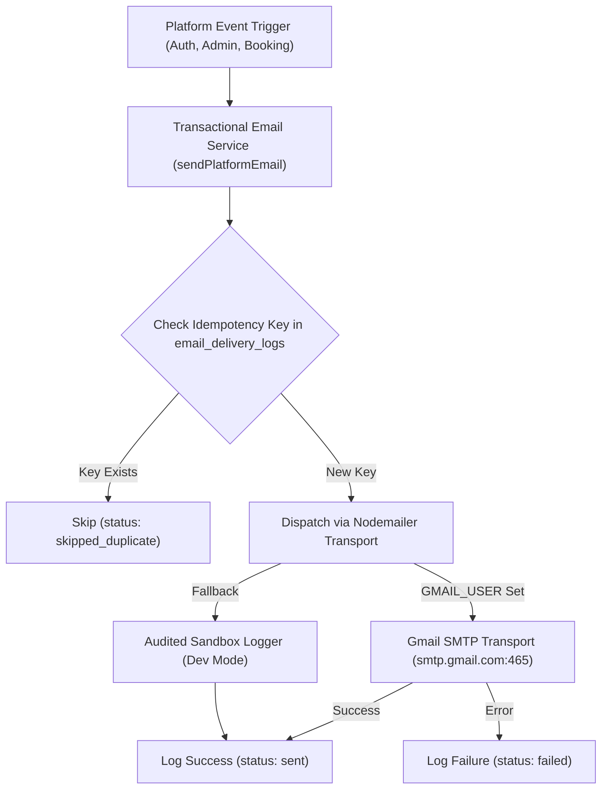

# Transactional Email & Notification Workflow

## 1. Architecture Overview

Transactional communications in SnapShoot operate through a resilient server-side service (`apps/web/src/lib/server/email.ts`) paired with persistent PostgreSQL delivery logs (`email_delivery_logs`).



---

## 2. Supported Email Transports

### 2.1 Gmail SMTP Integration
To send live transactional emails from a Gmail account:
- Set `GMAIL_USER=your-address@gmail.com`
- Set `GMAIL_APP_PASSWORD=xxxx-xxxx-xxxx-xxxx` (Generated via Google Account $\rightarrow$ Security $\rightarrow$ 2-Step Verification $\rightarrow$ App Passwords)
- Sender format: `"SnapShoot Visual Marketplace" <your-address@gmail.com>`

### 2.2 Generic Enterprise SMTP
- `SMTP_HOST`: e.g. `smtp.sendgrid.net`, `smtp.mailgun.org`, or `email-smtp.us-east-1.amazonaws.com`
- `SMTP_PORT`: 587 or 465
- `SMTP_USER`: SMTP username / API key
- `SMTP_PASSWORD`: SMTP secret

### 2.3 Resilient Sandbox Transport (Zero-Crash Fallback)
If SMTP credentials are not present during local testing or CI pipelines, the email service operates in safe sandbox mode:
- Formats the complete HTML and text templates.
- Emits structured debug logs to the Node server console.
- Inserts an authoritative record into `email_delivery_logs` with status `sent`.
- **Guarantee**: Temporary email service downtime never aborts the primary database transaction or booking creation.

---

## 3. Email Delivery Audit Trail (`email_delivery_logs`)

```sql
CREATE TABLE IF NOT EXISTS public.email_delivery_logs (
  id UUID PRIMARY KEY DEFAULT gen_random_uuid(),
  recipient_email TEXT NOT NULL,
  recipient_user_id UUID,
  template_name TEXT NOT NULL,
  event_type TEXT NOT NULL,
  subject TEXT NOT NULL,
  status TEXT NOT NULL DEFAULT 'pending', -- 'sent', 'failed', 'skipped_duplicate'
  error_message TEXT,
  idempotency_key TEXT,
  sent_at TIMESTAMPTZ,
  created_at TIMESTAMPTZ NOT NULL DEFAULT NOW()
);

CREATE INDEX IF NOT EXISTS idx_email_logs_idempotency 
ON public.email_delivery_logs(idempotency_key) 
WHERE idempotency_key IS NOT NULL;
```

---

## 4. Platform Event Catalog

| Event Name | Recipient | Trigger Point | In-App Alert | Email Dispatched |
|---|---|---|---|---|
| `auth.otp_requested` | User / Creator | User submits email on Login or Register | No | 6-digit verification code with 10m TTL |
| `creator.application_submitted` | Photographer | Completes onboarding form | Yes | Application confirmation |
| `creator.application_approved` | Photographer | Admin clicks "Approve" in Verification Queue | Yes | "Congratulations! Profile Approved & Published" |
| `creator.application_rejected` | Photographer | Admin clicks "Reject" (mandatory reason) | Yes | "Action Required: Update Profile" + Rejection Reason |
| `booking.created` | Customer & Photographer | Customer confirms shoot booking | Yes (Both) | Summary snapshot with distance & pricing breakdown |
| `booking.confirmed` | Customer | Photographer accepts shoot request | Yes | Final shoot confirmation & venue details |
| `booking.cancelled` | Customer & Photographer | Shoot cancelled by either party | Yes (Both) | Cancellation notice and refund policy info |
| `booking.reminder_24h` | Customer & Photographer | Scheduled Cron API (`/api/bookings/reminders`) | Yes (Both) | Pre-event reminder 24h-48h before shoot |

---

## 5. Scheduled Pre-Event Reminders

Reminders are automated via the endpoint `GET /api/bookings/reminders`:
1. Scans `bookings` where `status = 'confirmed'`.
2. Filters for `event_date` within the upcoming 24 to 48 hour window.
3. Computes idempotency key `reminder-booking-<booking_id>`.
4. If not yet sent, dispatches HTML reminder emails to both customer and photographer.
5. In production, configure a cron job or scheduled task calling:
   ```bash
   curl -X GET https://your-domain.com/api/bookings/reminders -H "Authorization: Bearer <CRON_SECRET>"
   ```
