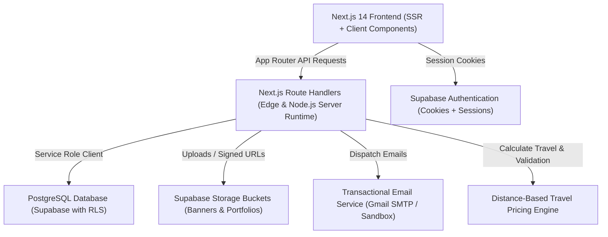

# SnapShoot Photographer Marketplace - Project Architecture

## 1. System Overview

SnapShoot is an enterprise-grade photography services marketplace connecting **Customers**, **Photographers (Creators)**, and **Platform Administrators**. The platform is structured as a high-performance TypeScript monorepo powered by Turborepo.

---

## 2. Monorepo Structure

| Path | Description | Tech Stack |
|---|---|---|
| `apps/web` | Customer, Photographer, and Admin web application | Next.js 14 (App Router), React 18, Tailwind CSS, Lucide Icons |
| `apps/api` | Backend microservices and administrative endpoints | NestJS, TypeScript, Jest |
| `packages/*` | Shared configurations, UI primitives, and TypeScript types | ESLint, TypeScript |
| `supabase/migrations` | Authoritative PostgreSQL schema and RLS policies | SQL, PostgreSQL 15 |

---

## 3. Core Architectural Modules

### 3.1 Three-Tier Role Isolation
1. **Customer Role (`customer`)**:
   - Profile discovery, search & filtering by city hub and category.
   - Live location-aware distance pricing calculation.
   - Booking creation, status tracking, customer notifications, and review submissions.
2. **Photographer Role (`creator` / `photographer`)**:
   - Studio onboarding with mandatory equipment, bio, city, and identity details.
   - Studio Profile Cover Banner management (independent Supabase object storage path).
   - High-resolution Portfolio Gallery uploads with categorisation and captions.
   - Travel Pricing Rules configuration (base hub, service radius, included km, rate per km, minimum fee).
   - Booking request management (accept, decline, complete) and earnings ledger.
3. **Admin Operations Desk (`admin` / `owner`)**:
   - Verification queue: review identity proof, equipment, cover banner, and portfolio showcase.
   - Approve profile: triggers database update, public catalogue publication, Gmail notification, and in-app alert.
   - Reject profile: requires mandatory rejection reason, logs decision audit trail, and notifies photographer.
   - Dispute management, audit logs, and platform health analytics.

---

### 3.2 Storage Architecture: Cover Banner vs. Portfolio Separation
A critical architectural constraint enforced in this system:
- **Cover Banner**: Stored in `creator_profiles.cover_image_url`. Managed via `/api/photographers/banner`. High-aspect ratio studio banner displayed on top of public and studio profile pages.
- **Portfolio Images**: Stored in `portfolio_items` table linked by `creator_profile_id`. Managed via `/api/photographers/portfolio`. Supports multiple gallery photographs with captions, categories, and ordering.
- These two media pipelines are strictly decoupled to guarantee banner uploads never overwrite gallery items.

---

### 3.3 Authoritative Distance-Based Pricing Engine
To prevent pricing anomalies where different locations produce identical fees:
- **Geodesic Haversine Computation**: Computes exact straight-line distance in kilometres using spherical trigonometry with Earth radius $R = 6371\text{ km}$.
- **City Hub Dictionary**: Maps 20+ major Indian metropolitan centers (Delhi NCR, Greater Noida, Mumbai, Bengaluru, etc.) to precise coordinates if geocoding coordinates are missing.
- **Server-Side Financial Snapshot**: The client requests live estimates via `/api/bookings/quote`. When a booking is submitted via `/api/bookings/create`, the server recalculates the distance, verifies the photographer's package price, applies travel fee rules, and saves an immutable snapshot in `bookings.pricing_breakdown`. Client-tampered amounts are strictly rejected.

---

### 3.4 Transactional Email & In-App Notification Engine
- **Email Service (`apps/web/src/lib/server/email.ts`)**:
  - Connects to Gmail SMTP (`GMAIL_USER`, `GMAIL_APP_PASSWORD`) or generic SMTP.
  - Falls back to structured delivery audit logging (`email_delivery_logs`) in development/sandbox environments.
  - Employs SHA-256 idempotency hashing to prevent duplicate emails.
- **In-App Notifications (`apps/web/src/lib/server/notifications.ts` & `useNotifications.ts`)**:
  - Subscribes dashboards to database notifications with automatic polling and mark-as-read endpoints.
  - Linked action URLs navigate users directly to relevant booking or review records.
